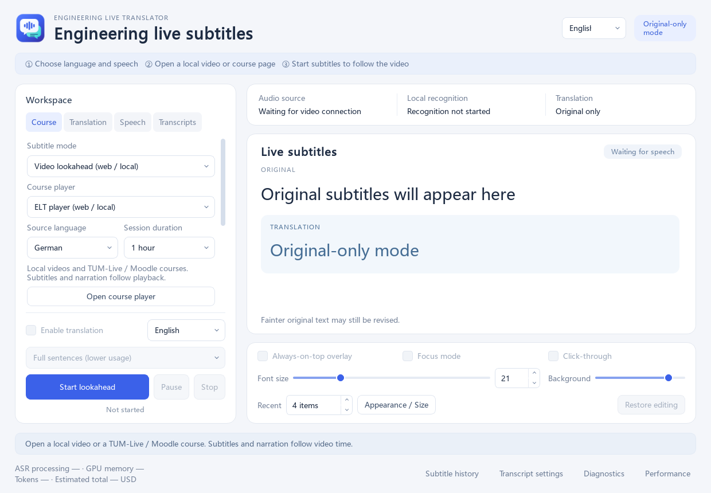

# Engineering Live Translator (ELT)

[简体中文](README.md) · [English](README.en.md)

**Desktop subtitles and translated narration for Windows 11.** Select an application audio source, or open a web or local course video. ELT transcribes audio locally and can translate the result into Chinese or English.

Validated video lookahead is integrated into the desktop application. Use the built-in course player or follow an existing page through the Edge extension. You control playback, pausing and seeking.



## Features

- **Three input paths:** Windows application process-tree audio, web video lookahead and local video lookahead. Application discovery uses Windows audio sessions; a browser process tree may contain several windows or tabs.
- **Eight source languages:** German, English, Japanese, Chinese, French, Russian, Italian and Korean, plus automatic detection.
- **Chinese and English interfaces:** choose a language and reopen the application to apply it.
- **Chinese and English translation targets:** source language, interface language and translation target are independent.
- **Two translation modes:** live preview or complete sentences. Source text remains visible when translation is unavailable.
- **Multiple API providers:** DeepSeek, OpenAI (GPT), Anthropic (Claude) and Gemini, with separate keys and model choices.
- **Local narration:** Qwen3-TTS 0.6B / 1.7B or Windows system voices. Speech follows the Chinese or English target, with adjustable base speed, volume, source ducking and buffered backlog catch-up.
- **Subtitle controls:** multiple bilingual sentences, movable focus, history browsing, adjustable window size and font size. Web subtitles use a compact overlay and quick controls.
- **Video synchronization:** supported videos are transcribed and translated ahead of playback. Narration keeps its base speed when it fits and speeds up only when necessary.
- **Usage and transcripts:** reported token counts, DeepSeek cost estimates based on a price snapshot, optional bilingual TXT transcripts and AI course notes.

## What is included

This is a **source repository** containing the application, native capture component, tests, non-secret configuration, terminology and build tools.

API keys, personal settings, transcripts, course media, model weights, Python environments, GPU runtime libraries and compiled executables are excluded. A fresh clone requires setup. Existing local installations can keep using their EXE and desktop shortcut.

## Requirements

| Component | Validated configuration |
|---|---|
| Operating system | Windows 11 x64 |
| Main environment | Python 3.12.10; project requirement `>=3.12,<3.13` |
| Interface | PySide6 6.8.3; WebView2 Runtime for the built-in player |
| Native build | Visual Studio 2022 Build Tools: MSVC v143, Windows SDK and CMake |
| Recognition | Faster-Whisper 1.2.1, CTranslate2 4.6.0, large-v3-turbo |
| Recognition GPU libraries | CUDA 12.4.1 / cuDNN 9.1.0 prepared by the setup tool |
| Optional local narration | Separate `.venv-tts`; see `requirements-tts-lock.txt` |

Recognition defaults to an NVIDIA GPU. Windows system voices do not require a Qwen model. Qwen supports GPU or CPU execution. Memory use, sustained throughput and subtitle latency depend on your hardware, model and material.

## Run from source

Run the following PowerShell commands from the repository root.

### 1. Application dependencies and native capture

```powershell
py -3.12 -m venv .venv
.\.venv\Scripts\python.exe -m pip install -e '.[asr,translation,ui,test,evaluation]'
.\tools\build.ps1
```

For a custom Build Tools installation, pass `build.ps1 -BuildToolsPath 'your installation path'`. The built-in player also requires Microsoft Edge WebView2 Runtime.

### 2. Recognition model and GPU libraries

```powershell
.\.venv\Scripts\python.exe tools/prepare_model.py
.\.venv\Scripts\python.exe tools/setup_gpu.py
```

Download tools use specified revisions and verification metadata, storing resources inside the project. They do not replace your GPU driver or modify the global PATH. Recognition settings are in `config/asr.toml`.

### 3. Optional Qwen narration

Skip this step if you only need Windows system voices.

```powershell
py -3.12 -m venv .venv-tts
.\.venv-tts\Scripts\python.exe -m pip install -r requirements-tts-lock.txt
.\.venv\Scripts\python.exe tools/download_tts_assets.py --only model
```

To also download the 1.7B model:

```powershell
.\.venv\Scripts\python.exe tools/download_tts_assets.py --only model --model-size 1.7B
```

### 4. Launch

```powershell
.\.venv\Scripts\python.exe -m app.ui.main
```

You can also double-click `启动ELT.cmd`. To build an executable launcher without a console window:

```powershell
.\.venv\Scripts\python.exe tools/build_launcher.py
```

Then double-click the generated `ELT.exe`. Keep the application, models and runtime directories together.

## Using ELT

1. Choose the interface language at the top right. Reopen ELT after changing it.
2. Select application audio subtitles or video lookahead (web / local).
3. Choose the lecture's source language. Enable translation and select **Chinese / English**, then choose live preview or full-sentence translation.
4. Configure your provider and API key in the Translation tab. Keys are stored in Windows Credential Manager. Do not put keys in source files, command-line arguments or chat.
5. For application audio, briefly play sound so the application appears in the list. You may pause the course yourself while recognition and capture prepare, then resume.
6. For lookahead, open the built-in player and choose a local file or course page. Sign in inside that window if needed. For Edge, follow `experiments/lookahead/extension/INSTALL.md` to install and pair the extension.
7. Choose Qwen or Windows narration, base speed and volume in Speech settings. Enable source ducking if desired. You remain in control of the video.
8. To save transcripts, explicitly enable saving and select a folder. Incomplete translations are marked.

## Current boundaries

- Automatic web discovery targets the configured TUM-Live and Moodle/Opencast sites. ELT is not a universal website downloader and does not bypass DRM or access controls.
- Application capture isolates a process tree, not necessarily one tab inside a shared browser process.
- Lookahead needs accessible on-demand media. Expired segments may be skipped, and translation or narration may not keep up with every speaking rate. ELT does not pause video automatically while waiting.
- Translation APIs receive the required text, relevant terminology and bounded context. Raw course audio is processed locally by default. Your selected API provider charges for its usage.
- Interface localization does not rewrite course pages, source transcripts, file paths or operating-system dialogs.
- Full one-hour stability, mixed-DPI behavior and extended course-quality evaluation remain pending. Available features do not imply that every performance target has been met.

## Tests

```powershell
.\.venv\Scripts\python.exe -m pytest tests/unit tests/integration -m 'not hardware'
node --test tests/unit/*.test.mjs experiments/lookahead/tests/*.test.mjs
```

Tests need their development dependencies and relevant Windows components. Run hardware cases separately; mock API results do not establish real course performance. The English-language update recorded 889 passing Python regression tests, followed by additional passing focused checks, and 75 passing JavaScript tests. See [language settings and verification](docs/LANGUAGE_OPTIONS.md) for scope and evidence references.

## Layout

```text
app/          Audio, recognition, translation, subtitles, narration and UI
native/       Process audio capture and executable launcher
config/       Non-secret example configuration
terminology/  Maintainable engineering terminology
tests/        Unit and integration tests
tools/        Build, asset preparation, diagnostics and source export
docs/         Architecture, usage and validation notes
experiments/  Compatibility entry points and extension installation folder
```

Historical validation documents may reference local evidence that is not uploaded. Development tools can regenerate relevant outputs. Third-party libraries and models retain their respective licenses.
