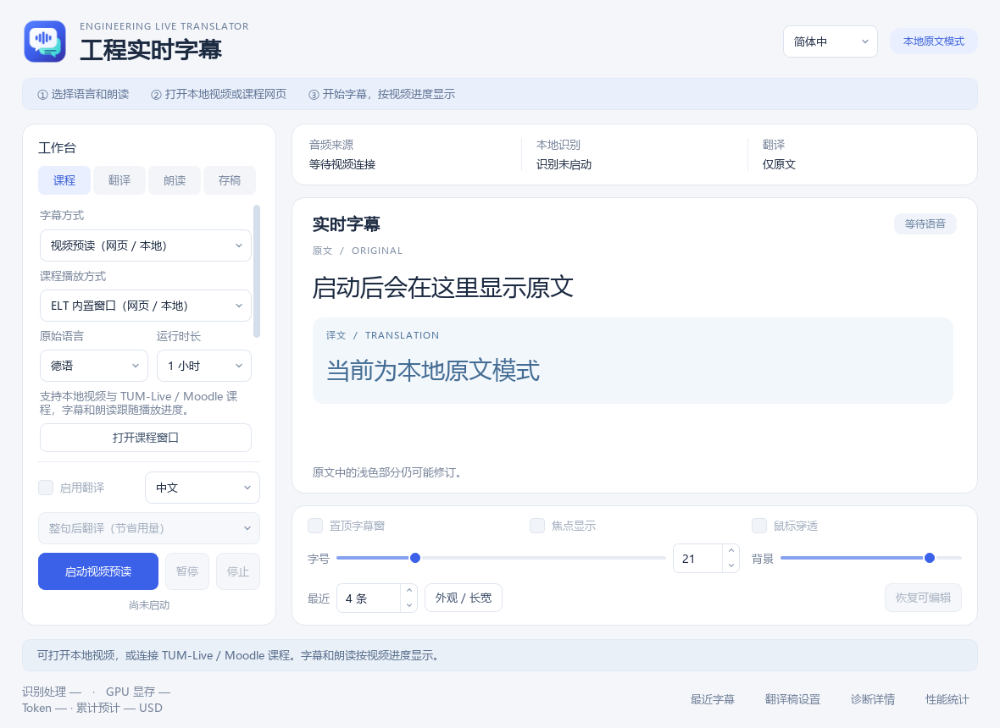

# Engineering Live Translator (ELT)

[简体中文](README.md) · [English](README.en.md)

**下载使用：** [Windows 11 便携版](https://github.com/yangxinchen2002-lgtm/yxc/releases/tag/v0.1.0-preview.20261104) · [软件和模型部署教程](docs/MODEL_SETUP.md)。可运行程序在 Release 的 Assets 中；请下载全部基础分卷与一键解压工具，解压后双击 ELT.exe。预览版不含个人密钥、字幕或课程登录资料。

**Windows 11 桌面字幕与译文朗读工具。** 从 Windows 应用音频中选择来源，或打开网页／本地课程视频，使用本地语音识别生成原文，再按需翻译为中文或英文。

ELT 将已经验证可行的课程视频预读功能整合进桌面程序。可以使用内置播放器，也可以通过 Edge 扩展跟随原网页播放器。视频的播放、暂停、跳转始终由用户控制。



## 功能

- **三种来源**：Windows 应用进程树音频、网页视频预读、本地视频预读。应用列表来自 Windows 音频会话，浏览器可能包含多个窗口或标签页。
- **八种原始语言**：德语、英语、日语、中文、法语、俄语、意大利语、韩语，以及自动识别。
- **两种界面语言**：简体中文和 English，选择后重新打开软件生效。
- **两种翻译目标**：中文和英文。原始语言、界面语言、翻译目标分别设置。
- **两种翻译方式**：实时预览、整句后翻译；原文实时显示，译文失败时保留原文。
- **多来源 API**：DeepSeek、OpenAI（GPT）、Anthropic（Claude）、Gemini，分来源保存密钥并选择服务与模型。
- **本地朗读**：Qwen3-TTS 0.6B / 1.7B 或 Windows 系统音色；朗读随中文／英文目标切换，支持基础语速、音量、原声降低与有缓冲的积压追赶。
- **字幕与焦点**：多句双语悬窗、可拖动焦点、历史回看、窗口大小和字号调整。网页字幕提供紧凑显示与顶部快捷设置。
- **预读同步**：为支持的视频提前识别和翻译，按原播放器时间显示并朗读；能正常读完时保持基础速度，来不及时加速。
- **用量与存稿**：读取实际返回的 Token；DeepSeek 另提供价格快照估算。可选自动保存双语 TXT、生成 AI 课程梳理。

## 仓库包含什么

这是**源码仓库**，包含应用、原生捕获组件、测试、非秘密配置、术语与构建工具。

不包含 API 密钥、个人配置、字幕稿、课程媒体、模型权重、Python 环境、GPU 运行库和编译后的 EXE。源码克隆后需要完成部署；已有本机安装仍可使用原有 EXE 和桌面快捷方式。

## 环境

| 项目 | 当前验证组合 |
|---|---|
| 系统 | Windows 11 x64 |
| 主环境 | Python 3.12.10；项目支持 `>=3.12,<3.13` |
| 界面 | PySide6 6.8.3；内置视频使用 WebView2 Runtime |
| 原生构建 | Visual Studio 2022 Build Tools：MSVC v143、Windows SDK、CMake |
| 语音识别 | Faster-Whisper 1.2.1、CTranslate2 4.6.0、large-v3-turbo |
| 识别 GPU 运行库 | 安装工具准备的 CUDA 12.4.1 / cuDNN 9.1.0 组合 |
| 可选本地朗读 | 独立 `.venv-tts`；版本见 `requirements-tts-lock.txt` |

识别默认使用 NVIDIA GPU。系统音色不需要 Qwen 模型；Qwen 可选 GPU 或 CPU。所需显存、持续速度和字幕延迟取决于模型、素材与设备，不预先保证。

## 从源码运行

在项目根目录使用 PowerShell。

### 1. 主程序和原生组件

```powershell
py -3.12 -m venv .venv
.\.venv\Scripts\python.exe -m pip install -e '.[asr,translation,ui,test,evaluation]'
.\tools\build.ps1
```

Build Tools 安装在自定义目录时，使用 `build.ps1 -BuildToolsPath '你的安装目录'`。内置播放器还需要已安装的 Microsoft Edge WebView2 Runtime。

### 2. 识别模型和 GPU 运行库

```powershell
.\.venv\Scripts\python.exe tools/prepare_model.py
.\.venv\Scripts\python.exe tools/setup_gpu.py
```

下载脚本使用指定版本与校验信息，资源存放在项目内。不会替你更换显卡驱动或修改全局 PATH。识别参数位于 `config/asr.toml`。

### 3. 可选：Qwen 本地朗读

只使用 Windows 系统音色时可跳过这一步。

```powershell
py -3.12 -m venv .venv-tts
.\.venv-tts\Scripts\python.exe -m pip install -r requirements-tts-lock.txt
.\.venv\Scripts\python.exe tools/download_tts_assets.py --only model
```

需要 1.7B 模型时另运行：

```powershell
.\.venv\Scripts\python.exe tools/download_tts_assets.py --only model --model-size 1.7B
```

### 4. 启动

```powershell
.\.venv\Scripts\python.exe -m app.ui.main
```

也可双击 `启动ELT.cmd`。如需无控制台的 EXE 入口：

```powershell
.\.venv\Scripts\python.exe tools/build_launcher.py
```

随后双击生成的 `ELT.exe`。模型与运行库继续保留在完整项目目录中。

## 使用

1. 右上角设置界面语言；切换界面语言后重新打开 ELT。
2. 选择字幕方式：应用音频实时字幕，或视频预读（网页／本地）。
3. 设置讲课的原始语言。启用翻译后，在旁边选择 **中文 / English**，再选择实时预览或整句模式。
4. 在翻译页配置自己的 API 密钥与服务。密钥保存在 Windows 用户凭据库；不要放进仓库、命令行参数或聊天。
5. 使用应用音频时，先让目标应用播放声音，使其出现在列表中。可自行暂停课程，等模型和音频连接准备好后继续播放。
6. 使用视频预读时，打开内置课程窗口并选择本地文件或课程网页；需要时自行在该窗口登录。Edge 模式按 `experiments/lookahead/extension/INSTALL.md` 安装并配对扩展。
7. 在朗读页选择 Qwen 或 Windows 音色、基础语速和音量；需要时降低原声。视频仍由你控制。
8. 需要存稿时主动开启保存并选择文件夹，未完成译文会明确标注。

## 支持边界

- 网页自动发现目前面向 TUM-Live 与 Moodle/Opencast 的指定站点。不是通用的全网站视频下载器；不绕过 DRM 或访问限制。
- Windows 应用捕获按进程树隔离，无法保证只捕获同一浏览器进程中的一个标签页。
- 预读需要可访问的点播媒体。过期片段可能跳过，翻译与朗读不能保证赶上所有语速；不会为等待字幕自动暂停视频。
- API 翻译发送所需文本、相关术语与有限上下文；原始课程音频默认在本机处理。API 费用由用户所选服务收取。
- 英文界面不翻译课程网页、原文、文件路径或操作系统自身的窗口。
- 完整一小时稳定性、混合 DPI、长课程识别／翻译质量仍有待补充验收。不要把功能可用等同于所有性能目标已达到。

## 测试

```powershell
.\.venv\Scripts\python.exe -m pytest tests/unit tests/integration -m 'not hardware'
node --test tests/unit/*.test.mjs experiments/lookahead/tests/*.test.mjs
```

测试需要对应开发依赖和 Windows 组件。需要实际设备的用例应单独执行，模拟 API 不代表真实课程测试。英文功能更新的完整回归记录为 889 项 Python 通过，后续专项另有通过记录；JavaScript 75 项通过。界面覆盖与实测范围见 [语言设置说明](docs/LANGUAGE_OPTIONS.md)。

## 项目结构

```text
app/          音频、识别、翻译、字幕、朗读与桌面界面
native/       进程音频捕获及原生启动器
config/       非秘密配置示例
terminology/  可维护的工程术语
tests/        单元与集成测试
tools/        构建、资源准备、诊断与导出
docs/         架构、使用及验证说明
experiments/  已验证功能的兼容入口和扩展安装目录
```

历史验证文档可能引用未上传的本机证据文件，开发工具可重新生成相关测试输出。第三方库与模型分别遵循其发布者的许可证。
